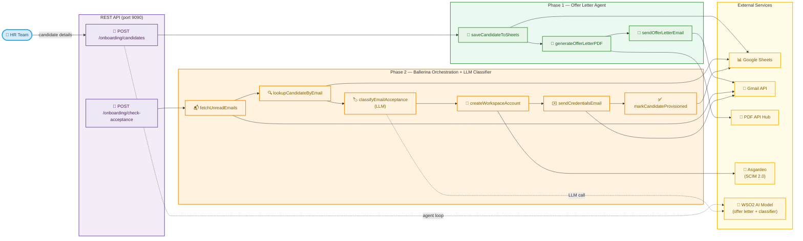

# Employee Onboarding Automation

## Description

This sample automates the employee onboarding lifecycle. When HR submits a new candidate's details, the service saves the record in Google Sheets and generates a personalized PDF offer letter via PDF API Hub, then emails it to the candidate through Gmail. A background poller checks Gmail every 60 seconds for acceptance replies — once a candidate accepts, it creates a workspace account in Asgardeo via SCIM 2.0 (Asgardeo emails the candidate a password-set link), sends the candidate a welcome email with their work address, and marks the record as provisioned in Google Sheets. The acceptance check can also be triggered manually via a REST endpoint at any time.

## How It Works



## Prerequisites

- **Ballerina** 2201.14 or later — [download](https://ballerina.io/downloads/)
- **WSO2 Agent Builder** with the default WSO2 model provider configured. Run the **Configure default WSO2 model provider** command to populate `[ballerina.ai.wso2ProviderConfig]` in `Config.toml`.
- A **Google Cloud project** with the following APIs enabled and a **single** OAuth 2.0 client (Desktop app type) created:
  - Gmail API
  - Google Sheets API
- A **PDF API Hub** account and API key — [sign up at pdfapihub.com](https://pdfapihub.com) (free tier: 10 PDFs)

  > **Note:** PDF API Hub stores generated PDFs at the returned URL. Do not include confidential information in offer letters if third-party storage is a concern.

- A **WSO2 Identity Server / Asgardeo** organization with an M2M application authorized for the `internal_user_mgt_create` scope

### Getting an OAuth2 refresh token for Google APIs

1. Create a project in [Google Cloud Console](https://console.cloud.google.com)
2. Enable **Gmail API** and **Google Sheets API**
3. Create an OAuth 2.0 credential (Desktop app type) and note the client ID and secret
4. Go to [Google OAuth Playground](https://developers.google.com/oauthplayground), click the settings gear → **Use your own OAuth credentials** → enter your client ID and secret
5. Authorize with **both** scopes together:
   - `https://mail.google.com/` — for reading and sending Gmail
   - `https://www.googleapis.com/auth/spreadsheets` — for reading and writing Sheets
6. Click **Exchange authorization code for tokens** and copy the **Refresh token**

> **Note:** A single OAuth client and refresh token covers both Gmail and Sheets when both scopes are authorized together in step 5.

### Setting up the Candidates spreadsheet

Create a Google Sheet and note its ID from the URL (`https://docs.google.com/spreadsheets/d/<ID>/edit`). The sheet tab (default: `Candidates`) must have these columns in order:

| Column | Field | Notes |
|--------|-------|-------|
| A | name | Candidate full name |
| B | email | Personal email (used for lookup) |
| C | address | Mailing address |
| D | jobTitle | Job title |
| E | department | Department |
| F | salary | Annual salary |
| G | bankingInfo | Banking details |
| H | status | `no` = pending, `in_progress` = provisioning, `yes` = provisioned |

### Setting up Asgardeo for SCIM 2.0 user provisioning

1. Log in to [console.asgardeo.io](https://console.asgardeo.io)
2. Create an **M2M application**
3. Under **API Authorization**, grant access to **SCIM2 Users API** with the `internal_user_mgt_create` scope
4. Enable **Email OTP** or **Email Link** as the account verification method so Asgardeo can email candidates a password-set link
5. Note the **Client ID**, **Client Secret**, and your **organization name**

## Configuration

Create or update `Config.toml` in the package root with the following values:

```toml
[ballerina.ai.wso2ProviderConfig]
serviceUrl  = "<WSO2 AI service URL>"
accessToken = "<WSO2 AI access token>"

[wso2.employee_onboarding]

# Google OAuth2 — covers both Gmail and Google Sheets
googleClientId     = "<google-oauth-client-id>"
googleClientSecret = "<google-oauth-client-secret>"
googleRefreshToken = "<google-refresh-token>"   # single token covering both scopes

# Google Sheets
sheetsSpreadsheetId = "<spreadsheet-id>"   # from the Sheets URL: .../d/<ID>/edit
sheetsTabName       = "Candidates"          # worksheet tab name

# PDF API Hub
pdfApiHubKey = "<pdfapihub-api-key>"

# Asgardeo / WSO2 Identity Server (SCIM 2.0)
asgardeoOrg          = "<your-org-name>"    # from console.asgardeo.io/t/<org>
asgardeoClientId     = "<m2m-client-id>"
asgardeoClientSecret = "<m2m-client-secret>"
workspaceDomain      = "yourcompany.com"    # domain used for new work emails
```

> **Security notice:** The HTTP listener has no built-in authentication. Run this service locally only, or place it behind a reverse proxy with authentication before exposing it on a network.

## Running

```bash
cd employee-onboarding-automation
bal run
```

The service starts on **`http://localhost:9090`**.

## Usage Instructions

### Phase 1 — Send an offer letter

```bash
curl -X POST http://localhost:9090/onboarding/candidates \
  -H "Content-Type: application/json" \
  -d '{
    "name": "Jane Smith",
    "email": "jane@personal.com",
    "address": "123 Main St, Springfield",
    "jobTitle": "Software Engineer",
    "department": "Engineering",
    "salary": 95000,
    "bankingInfo": "Bank ABC - Account #12345"
  }'
```

**Success response:**
```json
{ "status": "success", "message": "Offer letter sent to jane@personal.com." }
```

**Duplicate candidate (409):**
```json
{ "error": "Candidate with email jane@personal.com already exists." }
```

What happens:
1. Candidate row is appended to Google Sheets with status `no` (banking info is saved to Sheets only — not sent to the LLM)
2. Personalised PDF offer letter is generated via PDF API Hub
3. PDF is emailed to the candidate as an attachment

### Phase 2 — Process acceptance (manual trigger)

Once the candidate replies to the offer letter email:

```bash
curl -X POST http://localhost:9090/onboarding/check-acceptance
```

**Success response:**
```json
{ "status": "success", "message": "Acceptance check completed." }
```

**Already running (503):**
```json
{ "error": "Acceptance check already in progress. Try again shortly." }
```

What happens:
1. Gmail inbox is scanned for unread replies to the offer letter
2. Each reply is matched against the Sheets candidate list by sender email
3. An LLM call determines whether the reply is a genuine acceptance (negations like "I cannot accept" are correctly handled as rejections)
4. A SCIM 2.0 user account is created in Asgardeo using `askPassword`, which triggers Asgardeo to email the candidate a secure link to set their own password
5. A welcome email is sent to the candidate with their new work email address
6. The Sheets row status is set to `yes`

> The acceptance check also runs **automatically every 60 seconds** in the background. Concurrent runs are prevented by a lock — the timer skips a cycle if a run is already in progress.

### Health check

```bash
curl http://localhost:9090/onboarding/health
```

```json
{ "status": "ok", "service": "employee-onboarding" }
```
