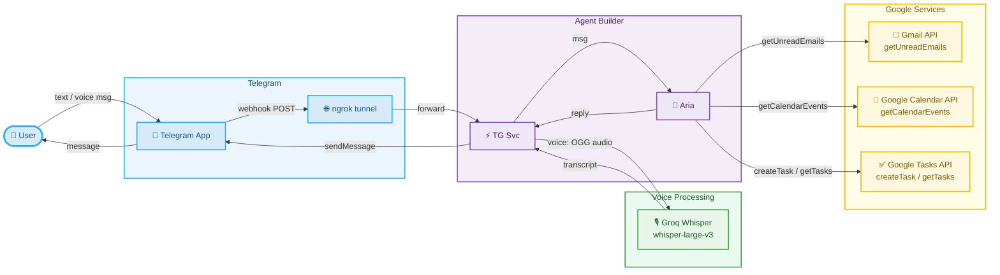

# Personal Life Manager

## Description

A personal life manager that you chat with on Telegram, powered by an AI agent named **Aria**. It checks your Gmail inbox for unread emails, fetches your Google Calendar events for any date, lists your pending Google Tasks, and creates new tasks for you. Text messages go straight to Aria; voice notes are first transcribed by Groq Whisper, so you can speak naturally instead of typing. This sample shows how to build a voice- and text-capable AI agent in Ballerina that connects Telegram to real Google services.

## How It Works



## Prerequisites

- ngrok — [download for your OS](https://ngrok.com/download) or `brew install ngrok` on Mac
- A Telegram bot token from [@BotFather](https://t.me/botfather)
- A Google Cloud project with **Gmail API**, **Google Calendar API**, and **Google Tasks API** enabled, and an OAuth 2.0 refresh token with all three scopes
- A Groq API key from [console.groq.com](https://console.groq.com)
- WSO2 Integrator, with the default WSO2 model provider configured. In WSO2 Integrator, run the **Configure default WSO2 model provider** command. It adds the provider's settings to `Config.toml`.

### Getting OAuth2 tokens for Google APIs

1. Create a project in [Google Cloud Console](https://console.cloud.google.com)
2. Enable **Gmail API**, **Google Calendar API**, and **Google Tasks API**
3. Create OAuth 2.0 credentials (Desktop app type)
4. Use the OAuth Playground and include these scopes when authorizing:
   - `https://mail.google.com/`
   - `https://www.googleapis.com/auth/calendar`
   - `https://www.googleapis.com/auth/tasks`
5. Exchange for a refresh token and use it for `gmailRefreshToken`, `calendarRefreshToken`, and `tasksRefreshToken`

## Configuration

Provide the configuration through a `Config.toml` file in `personal_life_manager/`:

```toml
# Telegram
telegramBotToken = "<your bot token from BotFather>"
telegramCallbackUrl = "https://<your-ngrok-subdomain>.ngrok-free.app"

# Gmail OAuth2
gmailClientId     = "<Google Cloud client ID>"
gmailClientSecret = "<Google Cloud client secret>"
gmailRefreshToken = "<OAuth2 refresh token>"

# Google Calendar OAuth2
calendarClientId     = "<Google Cloud client ID>"
calendarClientSecret = "<Google Cloud client secret>"
calendarRefreshToken = "<OAuth2 refresh token>"
calendarId           = "primary"

# Google Tasks OAuth2
tasksClientId     = "<Google Cloud client ID>"
tasksClientSecret = "<Google Cloud client secret>"
tasksRefreshToken = "<OAuth2 refresh token>"
tasksListId       = "@default"

# Groq API (free tier — voice transcription via Whisper)
groqApiKey = "<your Groq API key>"

# Added by the "Configure default WSO2 model provider" command.
[ballerina.ai.wso2ProviderConfig]
serviceUrl  = "<SERVICE_URL>"
accessToken = "<ACCESS_TOKEN>"
```

## Usage Instructions

### Option 1 — Using `start.sh` (recommended)

Run this once from the project root. It kills stale processes, starts ngrok, auto-updates `telegramCallbackUrl` in `Config.toml`, and starts the agent:

```bash
chmod +x start.sh   # only needed the first time
./start.sh
```

### Option 2 — Manual steps (without `start.sh`)

1. Start ngrok in a separate terminal:

   ```bash
   ngrok http 8090
   ```

2. Copy the `https://xxxx.ngrok-free.app` URL shown by ngrok. Open `personal_life_manager/Config.toml` and update:

   ```toml
   telegramCallbackUrl = "https://xxxx.ngrok-free.app"
   ```

3. Start the agent in a second terminal:

   ```bash
   cd personal_life_manager/personal_life_manager
   bal run
   ```

---

### Talking to Aria

Once the agent is running, open Telegram, find your bot, and try any of these:

1. **Check unread emails:**

   ```
   What are my unread emails?
   ```

   Aria fetches your Gmail inbox and lists up to 10 unread messages with sender, subject, and snippet.

2. **Check today's calendar:**

   ```
   What's on my calendar today?
   ```

   Aria returns all events for the current date with start and end times.

3. **Check a specific date:**

   ```
   Any meetings on 2026-11-20?
   ```

   Aria fetches events for that date only.

4. **Create a task:**

   ```
   Add a task: Review project proposal, due 2026-11-20
   ```

   Aria creates the task in Google Tasks and confirms.

5. **List pending tasks:**

   ```
   What are my pending tasks?
   ```

   Aria lists all incomplete tasks with their due dates.

6. **Send a voice note:**

   Record any of the above as a voice message in Telegram and send it. Aria transcribes it with Groq Whisper and responds the same way as a text message.
